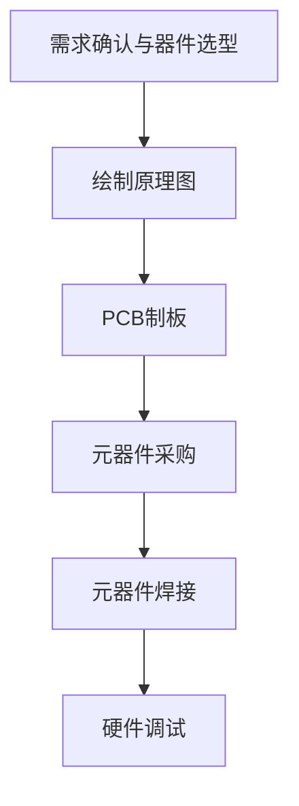
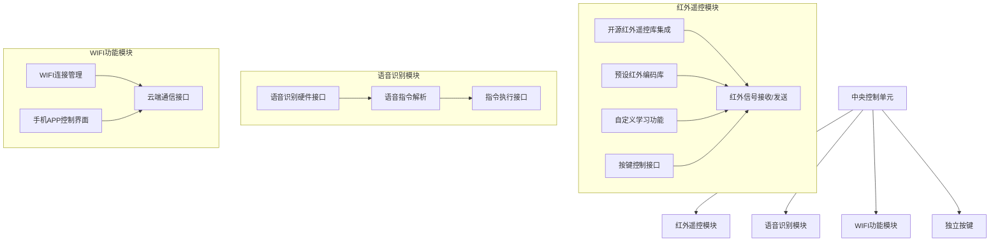

# 前言
帮朋友做的，基于ESP的红外遥控器，语音模块采用天问，整个项目比较简单。软件利用arduino库，红外遥控库，联网使用Blinker库

支持以下功能：
1. 按键遥控红外设备。
2. 语音遥控红外设备。
3. 连接WIFI，手机APP遥控红外设备。
4. 模式切换。
5. 支持红外学习模式。

# 器材采购
| 部件     | 型号                 | 用途     | 价格|链接|
| ------ | ------------------ | ------ |-------|-----|
| 主控   | ESP8266（CP2102）    | 系统核心控制 |¥10.5|[link](https://item.taobao.com/item.htm?abbucket=15&id=619991323193) |
| 红外收发模块 | 数字38KHz红外接收发射头     | 红外信号收发 |¥4.14|[link](https://detail.tmall.com/item.htm?id=720024442200)  |
| 语音识别模块 | 天问语音识别模块(ASR_PRO) | 语音指令识别    |¥29.1|[link](https://detail.tmall.com/item.htm?abbucket=15\&id=683860993579) |
| 锂电池x2      | 3.7V锂电池（PH2.0-500mAh）| 系统供电         | ¥15.0   | [Link](https://item.taobao.com/item.htm?id=714971603325&skuId=4997690252351)       |
| 按键   | 轻触开关6x6x6_smd              | 切换遥控对象 |¥2.97| [link](https://item.jd.com/10064231060192.html#crumb-wrap)| 
| 电源芯片   | pw5100-5v             | 锂电池升压 | ¥5+8 | [link](https://i-item.jd.com/10102424115848.html)| 
| 功率电感     |  0420-3.3uH     | 滤波   |¥5 |[link](https://ic-item.jd.com/10133696057167.html#none)| 
| 电源电容     |  22uF     | 滤波   | ¥3.8|[link](https://ic-item.jd.com/10101684718599.html#crumb-wrap)| 
| 电源电阻    |  0.5R     | 反馈   | ¥4.14 |[link](https://item.jd.com/10145360412447.html)| 

---

# 系统框图

# 原理图设计

# 引脚分配

# 设计流程图

# 软件架构框图:

---

# 博客链接
[https://github.com/heiweilu/ESP8266_Infrared](https://www.heiweilu.top/index.php/diyesphongwaiyaokongqi/)
